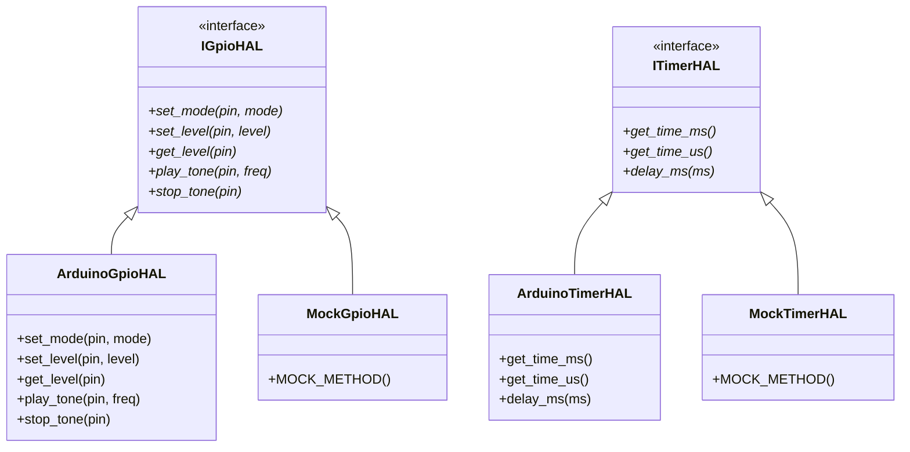
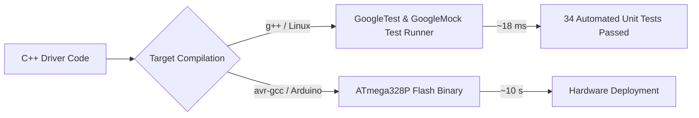
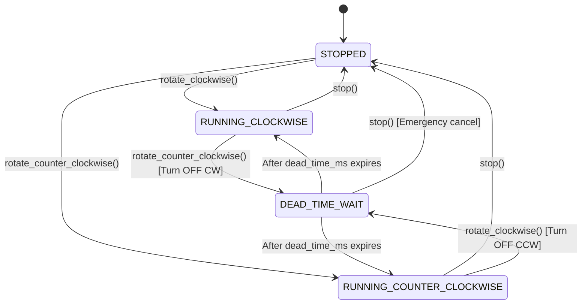
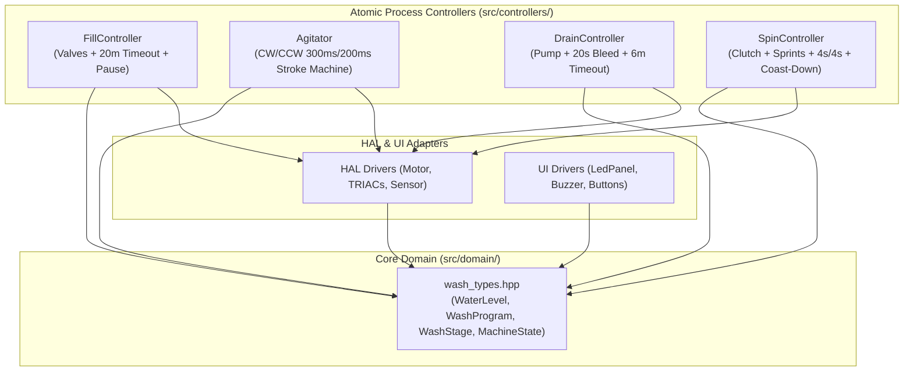
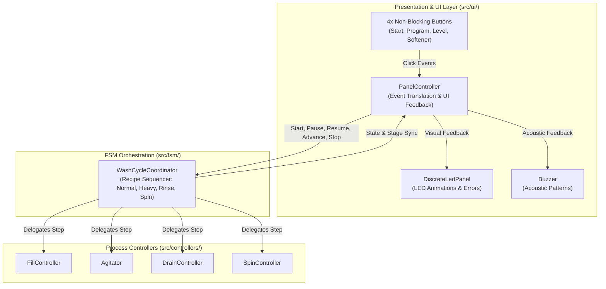
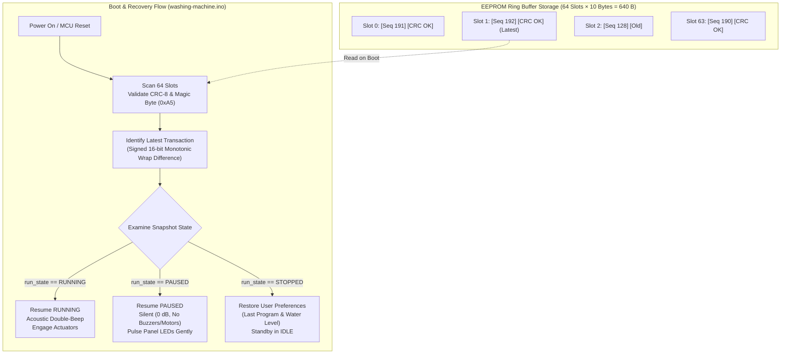

# From Spaghetti to Clean Embedded C++: The Washing Machine Case Study

> An engineering log about rebuilding a real washing machine controller: how a monolithic Arduino sketch became a test-driven, decoupled C++ firmware.

---

## Table of contents
1. [Introduction & Background](#introduction--background)
2. [Chapter 1: Deconstructing the Legacy Codebase (v0.1.0)](#chapter-1-deconstructing-the-legacy-codebase-v010)
3. [Chapter 2: Hardware Abstraction & Dependency Injection](#chapter-2-hardware-abstraction--dependency-injection)
4. [Chapter 3: Dual-Target Development with GoogleTest, Google Mock & Automated CI](#chapter-3-dual-target-development-with-googletest-google-mock--automated-ci)
5. [Chapter 4: Actuator Safety, Motor Dead-Time & Peripheral Drivers](#chapter-4-actuator-safety-motor-dead-time--peripheral-drivers)
6. [Chapter 5: Domain Modeling & Atomic Process Controllers (SRP)](#chapter-5-domain-modeling--atomic-process-controllers-srp)
7. [Chapter 6: Event-Driven Wash Cycle Coordinator FSM & Clean UI Architecture](#chapter-6-event-driven-wash-cycle-coordinator-fsm--clean-ui-architecture)
8. [Chapter 7: The WS2812B Addressable LED Engine, Hardware Re-spin & The AVR Interrupt Collision Dilemma](#chapter-7-the-ws2812b-addressable-led-engine-hardware-re-spin--the-avr-interrupt-collision-dilemma)
9. [Chapter 8: The Autonomous Safety Net - Hardware Watchdog, MPU-6050 Accelerometer, and Two-Tier Dynamic Anti-Walking Spin Control](#chapter-8-the-autonomous-safety-net---hardware-watchdog-mpu-6050-accelerometer-and-two-tier-dynamic-anti-walking-spin-control)
10. [Chapter 9: Field Service Self-Test & Diagnostic Architecture (v0.6.0)](#chapter-9-field-service-self-test--diagnostic-architecture-v060)
11. [Chapter 10: Non-Volatile State Persistence & AC Power-Loss Recovery (v0.7.0)](#chapter-10-non-volatile-state-persistence--ac-power-loss-recovery-v070)
12. [Chapter 11: Hardware Migration to 32-bit Architecture (ESP32-C3) *(Upcoming)*](#chapter-11-hardware-migration-to-32-bit-architecture-esp32-c3)

---

## Introduction & Background

In 2017, the proprietary control board in a domestic washing machine failed. Instead of discarding the machine, we reverse-engineered the electronics and replaced the board with an **ATmega328P (Arduino Pro Mini, 5V, 16MHz)** driving TRIACs for the motor, pumps, and valves.

The first prototype worked, but it was a single-file `.ino` sketch with the usual problems: blocking loops, global state, and no tests.

This document follows the rewrite from that prototype to the current C++ codebase.

---

## Chapter 1: Deconstructing the Legacy Codebase (v0.1.0)

Before refactoring, we analyzed the code smells and architectural bottlenecks in [`washing-machine.ino`](../washing-machine.ino):

### 1. The Monolithic `.ino` Anti-Pattern
All domain logic, hardware pin assignments, timing loops, UI debouncers, and safety timeouts lived in a single 800+ line file. Modifying one feature (e.g. adjusting agitation speed) risked breaking unrelated subsystems (e.g. water fill detection).

### 2. Blocking `delay()` and `while()` Traps
The firmware relied heavily on blocking loops:
```cpp
// Legacy blocking agitation loop:
while (now() <= tempoAvanco) {
    digitalWrite(motorDir, HIGH);
    delay(300);
    digitalWrite(motorDir, LOW);
    delay(200); // Motor dead-time
    digitalWrite(motorEsq, HIGH);
    delay(300);
    digitalWrite(motorEsq, LOW);
    delay(200);
}
```
**Why this is dangerous:** while the CPU sits in `delay()`, it cannot read sensors, handle a button press, or update the display.

### 3. Global Mutable State
Variables like `seletorPrograma`, `usaAmaciante`, `estadoChaveNivelB`, and `erro` were global. Any function could modify any state without validation, making the system prone to race conditions and difficult to reason about.

### 4. Zero Automated Testability
Because the code called Arduino hardware functions directly (`digitalRead`, `digitalWrite`, `pinMode`), it could not run on a PC. Every test required uploading to the board and waiting minutes for a cycle to finish.

---

## Chapter 2: Hardware Abstraction & Dependency Injection

To make the codebase testable and portable, we established the **Hardware Abstraction Layer (HAL)**.



### Key Design Decisions:

1. **Pure Abstract Interfaces:**
   - [`src/hal/interfaces/i_gpio_hal.hpp`](../src/hal/interfaces/i_gpio_hal.hpp): Encapsulates pin direction, digital I/O, and hardware tone generation.
   - [`src/hal/interfaces/i_timer_hal.hpp`](../src/hal/interfaces/i_timer_hal.hpp): Encapsulates system timestamp services (`millis`, `micros`).

2. **Constructor Dependency Injection via References (`&`):**
   Classes receive their dependencies as C++ references:
   ```cpp
   Button(hal::IGpioHAL& gpio_hal,
          hal::ITimerHAL& timer_hal,
          uint8_t pin,
          const ButtonConfig& config = ButtonConfig{});
   ```
   - **Guaranteed Non-Null:** Eliminates null pointer checks.
   - **Zero Heap Overhead:** No dynamic allocation (`new`/`malloc`/`shared_ptr`), critical for 2 KB SRAM microcontrollers.

3. **Macro Collision Avoidance:**
   Legacy Arduino headers define `#define HIGH 0x1`, `#define INPUT 0x0`. To prevent the C preprocessor from corrupting modern C++ `enum class` declarations, enum values use explicit scoped names: `hal::GpioMode::MODE_INPUT`, `hal::GpioLevel::LEVEL_HIGH`.

---

## Chapter 3: Dual-Target Development with GoogleTest, Google Mock & Automated CI

Testing started in `v0.2.0`, not at the end. Every driver and state machine runs on the host in milliseconds.



### 1. The Finite State Machine `Button` Driver
We created a non-blocking [`ui::Button`](../src/ui/button.hpp) driven by a 6-state FSM:
- **`WAIT_FOR_PRESS`**: idle, waiting for an active level.
- **`DEBOUNCE_PRESS`**: filters electrical noise glitches (< 20 ms).
- **`WAIT_FOR_RELEASE`**: measures press duration. The defaults are 1000 ms for a long press and 3000 ms for a very long press; the production build in `washing-machine.ino` uses 800 ms and 1600 ms.
- **`DEBOUNCE_RELEASE`**: confirms a clean release.
- **`WAIT_FOR_DOUBLE`**: waits 300 ms for a second click by default. The production build uses 100 ms because the panel does not use double-click, and the shorter window makes every button respond faster.
- **`TIMEOUT_WAIT_FOR_RELEASE`**: protects against physically stuck buttons (> 6000 ms).

### 2. Automated Continuous Integration (GitHub Actions)
We configured [`.github/workflows/ci.yml`](../.github/workflows/ci.yml) with automatic caching (`actions/cache@v4`):
- **Host tests:** GoogleTest and GoogleMock compile and run all unit tests in **~18 ms**.
- **AVR build:** `arduino-cli` compiles the full ATmega328P binary in **~10 s**.

---

## Chapter 4: Actuator Safety, Motor Dead-Time & Peripheral Drivers

The wash motor, drain pump, brake clutch, and solenoid valves are high-power AC inductive loads. Driving them, along with the panel, needs safety interlocks.



### 1. General Binary Loads: `DigitalOutput` & Intrusive Linked List
Single-pin binary actuators (inlet valves, drain pump, clutch actuator) are controlled via [`hal::DigitalOutput`](../src/hal/digital_output.hpp):
- **Intrusive Linked List Pattern:** Objects register themselves into a static linked list during construction without using dynamic memory (`new` / `malloc` / `std::vector`), allowing global batch operations (`DigitalOutput::init_all()`, `DigitalOutput::turn_off_all()`).
- **Active-low and active-high support:** drives direct-logic outputs and inverted relay modules.
- **Safety decision (no `turn_on_all`):** turning on every load at once (fill valves, heater, pump, and spin motor) could cause power surges or trip the domestic breaker. Only batch turn-off (`turn_off_all()`) exists, for fail-safe shutdowns.

### 2. Bidirectional AC motor: `ReversibleMotor`
A reversible AC induction motor has two directional windings (clockwise/right and counter-clockwise/left). If both are energized at once, the opposing magnetic fields lock the rotor. With no back-EMF, both windings draw locked-rotor current, which can exceed $10\times$ nominal and overheat the motor insulation and the power TRIACs.

[`hal::ReversibleMotor`](../src/hal/reversible_motor.hpp) enforces this in software:
1. **Mutual exclusion:** before setting either direction pin active, the opposite pin is forced to `LEVEL_LOW`.
2. **Non-blocking dead-time:** when reversing direction, both pins are de-energized and the driver enters `DEAD_TIME_WAIT`. The new direction is energized only after the configured dead-time (for example 200 ms).
3. **Emergency stop override:** calling `stop()` during the dead-time aborts the pending rotation, so the motor stays stopped.

### 3. Water Level Sensing: `PressureSwitchSensor`
The physical electromechanical pressure switch features mixed contact topologies:
- **Low Level (31-32):** Normally Closed (NC) $\rightarrow$ opens under pressure (`LEVEL_HIGH` when level reached).
- **Medium Level (11-13):** Normally Open (NO) $\rightarrow$ closes under pressure (`LEVEL_LOW` when level reached).
- **High Level (21-23):** Normally Open (NO) $\rightarrow$ closes under pressure (`LEVEL_LOW` when level reached).

[`hal::PressureSwitchSensor`](../src/hal/pressure_switch_sensor.hpp) normalizes these raw polarities and implements a **100 ms hydraulic stabilization filter** (*sloshing debouncer*) to prevent false triggering from water waves.

### 4. Non-Blocking Audio: `Buzzer` (Passive Transducer Engine)
The appliance uses a passive piezoelectric transducer without an internal oscillator. [`ui::Buzzer`](../src/ui/buzzer.hpp) uses non-blocking 3000 Hz hardware tone generation (`play_tone` / `stop_tone`) for the acoustic cues:
- `SHORT_BEEP` (50 ms button click feedback)
- `DOUBLE_BEEP` (function toggle)
- `CYCLE_FINISHED` (4 loud, repetitive beeps so the user hears the end from another room)
- `ERROR_ALARM` (continuous alternating alarm)

### 5. Decoupled Visual Feedback: `ILedPanel` & `DiscreteLedPanel`
To allow transitioning to addressable RGB LEDs (WS2812B) in the future without modifying domain logic, [`ui::ILedPanel`](../src/ui/interfaces/i_led_panel.hpp) provides a semantic visual interface (`set_stage(WashStage)`, `set_selected_level(WaterLevel)`, `set_softener(bool)`). The original [`ui::DiscreteLedPanel`](../src/ui/discrete_led_panel.hpp) drives the 7 physical panel LEDs; the current `main` build uses [`ui::StripLedPanel`](../src/ui/strip_led_panel.hpp) for the 9-pixel WS2812B strip (Chapter 7).

---

## Chapter 5: Domain Modeling & Atomic Process Controllers (SRP)

The next problem was coordination: how to run fill, agitation, drain, and spin without building another God Class.



### 1. Eliminating Coupling Inversion with Domain Types
In early prototypes, enums like `WashProgram` and `WashStage` were defined in `i_led_panel.hpp`, and `WaterLevel` was in `i_water_level_sensor.hpp`. This inverted dependency forced central business logic to include UI and sensor headers.

We extracted all core concepts into [`src/domain/wash_types.hpp`](../src/domain/wash_types.hpp) in namespace `domain`. The domain is now completely pure: HAL, UI, and business logic depend solely on the domain model.

### 2. Deconstructing the "God Class" via SRP
Instead of handling solenoid timings, motor reversals, and drain timeouts in one large coordinator, each physical operation became an **Atomic Process Controller** with the same lifecycle:

| Controller | Single Responsibility | Key Features |
| :--- | :--- | :--- |
| [`FillController`](../src/controllers/fill_controller.hpp) | Tub water intake | Controls main/softener solenoids; 20-min fail-safe timeout; `pause()` freezes timeout counter. |
| [`Agitator`](../src/controllers/agitator.hpp) | Mechanical fabric wash | 300 ms ON / 200 ms OFF stroke alternation; non-blocking CW/CCW reversal; preserves progress on `pause()`. |
| [`DrainController`](../src/controllers/drain_controller.hpp) | Water evacuation | Controls pump; detects empty tub; executes 20-sec residual water bleeding; 6-min timeout; `pause()` freezes bleeding. |
| [`SpinController`](../src/controllers/spin_controller.hpp) | Centrifugal water extraction | 5s clutch engagement; empirically tuned progressive sprints to overcome resonance oscillations; 4s ON / 4s OFF duty cycle; non-blocking transmission protection. |

### 3. Top-load transmission mechanics and inertia management
Domestic top-load washing machine transmissions (e.g. Whirlpool/Brastemp/Consul) have unique mechanical constraints:
- **Agitation Mode (Actuator OFF):** The outer drum is unclutched and free (not locked rigid), moving slightly back and forth due to water inertia and counter-inertia while the central shaft oscillates the agitator.
- **Spin Mode (Actuator ON):** The electromechanical linear actuator pulls a mechanical lever, engaging the clutch so that the agitator and drum lock together into a single spinning assembly driven at 700+ RPM.

#### The Decoupling Trap & Vane Breakage Risk:
If electrical power to the actuator is cut while the drum is spinning at full speed, the return spring snaps the arm back and decouples the agitator from the drum at 700+ RPM. With wet clothes pressed against the basket walls, the speed mismatch between the free drum and the driven agitator can shear the plastic vanes off the agitator, grind the clutch teeth, and shock the transmission.

#### The fix: non-blocking `COAST_DOWN` protection
In [`SpinController`](../src/controllers/spin_controller.hpp), normal completion, `pause()`, and `stop()` all pass through a 10-second `COAST_DOWN` phase:
1. Motor power is cut immediately.
2. The drain pump/actuator **stays energized** for 10 seconds, so the drum and agitator decelerate together under friction to a stop.
3. Only then does the controller de-energize the actuator, releasing the arm without a mechanical shock.

#### Rotational inertia duty cycle (4s ON / 4s OFF):
The single-phase AC induction motor does not run continuously during the spin. After the sprint ramp-down, it switches to **4000 ms ON / 4000 ms OFF**. The basket's angular momentum ($J \cdot \omega$) keeps it turning at extraction speed while halving the thermal and electrical load.

### 4. Test growth
Each process controller is tested on its own with GoogleTest and GoogleMock:
- `FillControllerTest` (6 tests): level cut-off, timeout detection, valve control, pause/resume.
- `AgitatorTest` (4 tests): CW/CCW alternation, off-pause timing, duration completion, pause/resume.
- `DrainControllerTest` (5 tests): empty detection, 20s bleed phase, timeout detection, pause/resume.
- `SpinControllerTest` (7 tests): clutch engage, level-dependent sprints, 4s/4s duty run, coast-down, soft pause, soft stop, emergency stop.
- `WashCycleCoordinatorTest` (8 tests): recipe sequencing, step advancement, error triggers, process delegation.
- `PanelControllerTest` (12 tests): button event handling, UI state transitions, audio feedback, differentiated error diagnostics.

**Total Host Tests:** **80 automated unit tests passing in ~42 ms**.

---

## Chapter 6: Event-Driven Wash Cycle Coordinator & UI Panel Orchestration

With the process controllers in place, the last piece of `v0.3.0` was the **WashCycleCoordinator** and the **PanelController**, wired together through dependency injection.



### 1. The `WashCycleCoordinator` Recipe Sequencer
The [`WashCycleCoordinator`](../src/fsm/wash_cycle_coordinator.hpp) runs the wash recipes without blocking:
- **Normal Wash:** Fill $\rightarrow$ Continuous Agitation (18m) $\rightarrow$ Drain $\rightarrow$ Rinse $\rightarrow$ Spin.
- **Heavy Wash:** Fill $\rightarrow$ Gentle Agitation (8m) $\rightarrow$ Long Soak (20m) $\rightarrow$ Normal Agitation (14m) $\rightarrow$ Drain $\rightarrow$ Rinse $\rightarrow$ Spin.
- **Rinse Only:** Single Rinse (no softener) or Double Rinse with Softener (Fill $\rightarrow$ Agitate $\rightarrow$ Drain $\rightarrow$ Interm Spin $\rightarrow$ Softener Fill $\rightarrow$ Agitate $\rightarrow$ Softener Soak $\rightarrow$ Post Agitate $\rightarrow$ Drain $\rightarrow$ Final Spin).
- **Spin Only:** Drain $\rightarrow$ 20s Bleed $\rightarrow$ Clutch Sprints $\rightarrow$ Continuous 4s/4s Spin $\rightarrow$ Coast-Down.

### 2. The `PanelController` Presentation Layer
The [`PanelController`](../src/ui/panel_controller.hpp) bridges user input with the domain:
- **Zero Polling in Domain:** Translates single clicks, long clicks (step advance), and very long clicks (cycle cancel) into coordinator commands.
- **Differentiated Error Diagnostics (Legacy Restored):**
  - `FILL_TIMEOUT` (20-min inlet fail-safe): Blinks all water level LEDs.
  - `DRAIN_TIMEOUT` (6-min pump fail-safe): Blinks all program stage LEDs.
- **Non-blocking visual and acoustic feedback:** keeps the power LED, stage progress, and tone patterns in sync without blocking.

### 3. Main System Assembly via Inversion of Control (`washing-machine.ino`)
The top-level sketch contains no business logic; it is only the **composition root**:
```cpp
void setup() {
    // 1. Initialize hardware I/O pins
    // 2. Initialize UI presentation
    panel_ctrl.init();
}

void loop() {
    // Non-blocking tick pump
    btn_start.update();
    btn_program.update();
    btn_water_level.update();
    btn_softener.update();

    coordinator.update();
    panel_ctrl.update();
    led_panel.update();
    buzzer.update();
}
```

### 4. Memory Footprint on ATmega328P (5V, 16MHz)
- **Flash ROM:** 14,976 bytes (**48%** of 30,720 bytes).
- **SRAM:** 721 bytes (**35%** of 2,048 bytes).
- **Dynamic Allocation (`heap`):** 0 bytes (100% static allocation).

---

## Chapter 7: The WS2812B Addressable LED Engine, Hardware Re-spin & The AVR Interrupt Collision Dilemma

The discrete LED release (`v0.3.1`) was working and archived. The wooden control panel made the next change attractive: replace the 7 through-hole LEDs and their harness with a **9-pixel WS2812B addressable RGB strip**. The strip needs one data pin instead of seven, which freed pins for the rearranged buttons and for SDA/SCL, leaving the I2C bus ready for the vibration sensor.

The upgrade brought three problems: cycle-accurate AVR assembly, analog voltage levels, and a timer interrupt collision.

```
Physical Layout of the 9-Pixel Strip (docs/box.webp):
[ P8 ]       [ P7 ]       [ P6 ]   [ P5 ]   [ P4 ]       [ P3 ]       [ P2 ]   [ P1 ]   [ P0 ]
Softener     Low          Medium   High     (Gap)        Heavy        Wash     Rinse    Spin
(Rose)       (Cyan)       (Cyan)   (Cyan)   (OFF)        (White)      (White)  (White)  (White)
  ◄────────────────────────────────── Physical Strip Orientation ────────────────────────────── DIN
```

---

### 1. The Zero-Heap 16 MHz AVR Assembly Driver (`Ws2812Strip`)

Libraries such as FastLED and Adafruit NeoPixel add flash overhead, dynamic allocation, and dependencies that a safety-critical ATmega328P application does not need. The only animation we use is breathing, so those libraries are overkill.

We wrote a small zero-heap driver [`Ws2812Strip`](../src/hal/ws2812_strip.hpp):
- **Static buffer:** exactly $9 \times 3 = 27$ bytes in GRB color order. Zero heap allocation.
- **Nanosecond-accurate inline assembly:** the WS2812B 800 kHz protocol requires strict timing:
  - Bit `0`: 350 ns HIGH followed by 800 ns LOW.
  - Bit `1`: 700 ns HIGH followed by 600 ns LOW.
- **Dynamic register mapping:** instead of hardcoding I/O ports in assembly, the driver resolves the AVR port address and bitmask at runtime (`portOutputRegister(digitalPinToPort(pin_))` and `digitalPinToBitMask(pin_)`), so changing the pin does not require recompiling the assembly.
- **Host testing:** in host mode (`-DHOST_TEST`), the driver logs byte buffers, which allows unit tests without hardware.

---

### 2. Polymorphic UI Abstraction (`StripLedPanel`)

Because of the [`ILedPanel`](../src/ui/interfaces/i_led_panel.hpp) interface from Chapter 6, moving from discrete LEDs to the RGB strip needed **no changes** to `PanelController` or the domain logic.

The [`StripLedPanel`](../src/ui/strip_led_panel.hpp) implements:
- **Multi-tone palette:** water levels glow in cyan (`0, 220, 255`), wash stages in warm white (`255, 197, 120`), and the softener indicator in rose (`255, 30, 140`).
- **Breathing animation (2-second period):** the active stage oscillates in brightness, future stages keep a faint 15% glow, finished stages turn off, and paused states blink the active stage.
- **Integer-only wave math:** a floating-point `sin()` would cost about 1.5 KB of AVR flash. The breathing animation uses a symmetrical integer triangle wave instead:
  ```cpp
  uint16_t phase = now % 2000;
  uint8_t wave = (phase < 1000) ? (phase * 255) / 1000 : ((2000 - phase) * 255) / 1000;
  ```
- **Isolated Diagnostic Strobe:** Inlet timeout (`FILL_TIMEOUT`) blinks water levels in Red; drain pump timeout (`DRAIN_TIMEOUT`) blinks program stages in Red.

---

### 3. Hardware re-spin and the analog D13 pull-up trap

The rewiring reduced the panel interconnect from 12 loose wires to one **7-conductor ribbon cable** with a shared ground:
- `+5V` (Strip VCC)
- `GND` (Common ground for WS2812 strip and all 4 pushbuttons)
- `D6` (WS2812 DIN data line, direct 0Ω connection)
- `D7 / A3` (Softener button)
- `A0 (Pin 14)` (Program button, with 1kΩ series protection)
- `A1 (Pin 15)` (Start-Pause button, with 1kΩ series protection)
- `A2 (Pin 16)` (Water Level button, with 1kΩ series protection)
- **Freed Pins:** Analog pins **`A4 (SDA)`** and **`A5 (SCL)`** were successfully liberated and reserved for the upcoming I2C accelerometer bus.

#### The D13 electrical clamping trap
On the first board, buttons on A0, A1, and A2 worked, but a button on **D13** did not register any clicks even though the contacts closed.

**Root cause:**
- On Arduino Pro Mini boards, D13 has a surface-mount LED and series resistor tied to GND.
- With D13 configured as `INPUT_PULLUP`, the weak internal pull-up (~30 kΩ) forms a voltage divider with the onboard LED.
- The forward voltage drop ($V_f$) of the red LED clamps the pin at $\approx 1.8\text{V} - 2.0\text{V}$ when the button is released.
- On an ATmega328P at 5V, the minimum HIGH input threshold ($V_{IH}$) is $0.6 \times V_{CC} = \mathbf{3.0\text{V}}$.
- At 1.8 V, the Schmitt trigger never saw a valid release (`LEVEL_HIGH`), so the button FSM stayed stuck.
- **Fix:** the buttons moved to GPIOs without onboard LEDs (A0, A1, A2, A3). The 1kΩ series resistors pull the pin down to $V_{pin} \approx 0.16\text{V} \ll 1.5\text{V}$ ($V_{IL}$), which also improves ESD and noise rejection.

---

### 4. The AVR Interrupt Collision Dilemma: Tone vs. CLI

Long beeps came out as a stuttering tremolo instead of a steady tone.

#### Analysis
1. The Arduino `tone()` function configures **Timer 2** in CTC mode to toggle the buzzer pin at 3000 Hz, firing an interrupt every **$166\,\mu\text{s}$**.
2. The WS2812B bit-banging protocol needs zero jitter, so interrupts are disabled (`cli()`) during transmission.
3. Transmitting 9 pixels ($9 \times 24\text{ bits} \times 1.25\,\mu\text{s}$) holds interrupts disabled for **$270\,\mu\text{s}$**.
4. Since $270\,\mu\text{s}$ is longer than $166\,\mu\text{s}$, the Timer 2 interrupt was late or missed **50 times per second** at 50 FPS, which modulated the carrier with a 50 Hz flutter.

#### The fix
WS2812 pixels latch their own data, so **the LEDs keep their state without continuous transmission**.

Instead of coupling the buzzer to the strip, `PanelController` coordinates the UI:
```cpp
void PanelController::update()
{
    buzzer_.update();

    // Suppress LED frame pushes during active audio output:
    if (!buzzer_.is_playing()) {
        led_panel_.update();
    }
    ...
```
- While a 50 ms click beep or the finish beeps play, frame transmission pauses.
- A 50 ms gap is invisible in a 2-second breathing wave, but the ear notices a disturbed 3000 Hz tone.
- The strip frame rate was also capped at **30 FPS** (`frame_interval_ms = 33`), which cut the CPU time spent on the WS2812 engine.

---

### 5. Appliance Standby & Wake-Up UX

- **Standby Sleep:** When the cycle completes, the coordinator enters `FINISHED`. The LED strip shuts off completely.
- **Wake-Up on Interaction:** Touching any configuration button (Program, Level, Softener) automatically calls `coordinator.stop_cycle()`, transitioning the machine back to `IDLE` and instantly waking up the LED display with the updated settings.

---

### 6. Milestone Metrics & Readiness (v0.4.0)

| Metric | Legacy v0.1.0 | FSM v0.3.1 (Discrete) | Strip v0.4.0 (WS2812) |
| :--- | :--- | :--- | :--- |
| **Flash ROM** | 7,130 B (23%) | 14,976 B (48%) | **15,822 B (51%)** |
| **Static SRAM** | 358 B (17%) | 721 B (35%) | **821 B (40%)** |
| **Dynamic Heap** | 0 B | 0 B | **0 B (Zero Heap)** |
| **Automated Tests** | 0 tests | 80 tests | **100 tests (100% pass, 30 ms)** |
| **Panel Wires** | 12 loose wires | 12 loose wires | **7-conductor flat ribbon** |
| **Free GPIOs** | 0 pins | 0 pins | **A4/A5 I2C + A6/A7 Free** |

The firmware is now **production-ready and field-tested** for all domestic washing machines with functional mechanical balance.

---

## Chapter 8: The autonomous safety net - hardware watchdog, MPU-6050 accelerometer, and two-tier dynamic anti-walking spin control

With the WS2812B interface and the free I2C pins (A4/A5) in place, `v0.5.0` took on the mechanical and safety work:
1. Recover from firmware hangs, brownouts, and electrical noise with the AVR hardware watchdog.
2. Add a 6-axis MPU-6050 over I2C without a third-party library or dynamic allocation.
3. Measure drum resonance and stop the machine from walking during spin acceleration.
4. Detect unbalance in real time, with gravity removed and separate shock and sustained thresholds.
5. Recover in two stages: dry redistribution inside `SpinController`, then hydraulic redistribution (fill, agitate, drain) inside `WashCycleCoordinator`.
6. Let the user resume after an error from the panel.

---

### 1. The AVR hardware watchdog and the Optiboot boot-loop trap

An appliance that switches inductive loads at mains voltage (127V / 220V AC) sees electrical noise, brownouts, and single-event upsets. Any of these can put a microcontroller into an undefined state.

A software-only safety monitor cannot recover from a frozen execution loop. We implemented the [`IWatchdogHAL`](../src/hal/interfaces/i_watchdog_hal.hpp) interface and [`ArduinoWatchdogHAL`](../src/hal/arduino/arduino_watchdog_hal.hpp), wrapping the native AVR watchdog library (`<avr/wdt.h>`).

#### The ATmega328P watchdog reset loop dilemma
On AVR, a watchdog reset leaves the Watchdog Timer enabled with the shortest prescaler (about 15 ms).

A standard bootloader or a long chain of C++ static initializers can take longer than 15 ms, so the chip resets before `main()` runs and repeats the loop (a watchdog reset storm).

#### The fix: `.init3` early initialization
The watchdog must be disabled before global C++ constructors run. The hook goes in the AVR compiler's `.init3` section:

```cpp
#ifdef __AVR__
#include <avr/wdt.h>

// Disable watchdog immediately after reset before C runtime initialization:
void early_watchdog_disable(void) __attribute__((naked, section(".init3")));
void early_watchdog_disable(void)
{
    MCUSR = 0;
    wdt_disable();
}
#endif
```

During normal operation, the watchdog is configured with a 2-second timeout window and kicked on every cycle of the non-blocking `loop()` tick pump:
```cpp
void loop() {
    watchdog.kick();
    ...
```
If any controller blocks or hangs for more than 2 seconds, the watchdog reboots the microcontroller into `IDLE`.

---

### 2. Zero-allocation MPU-6050 accelerometer driver over I2C

With analog pins `A4` (SDA) and `A5` (SCL) freed during the ribbon cable re-spin (Chapter 7), we integrated an MPU-6050 6-axis MEMS accelerometer onto the drum assembly.

Libraries such as Adafruit and I2Cdevlib add kilobytes of flash, dynamic math, and blocking delays. We wrote:
1. [`II2cHAL`](../src/hal/interfaces/i_i2c_hal.hpp) and [`ArduinoI2cHAL`](../src/hal/arduino/arduino_i2c_hal.hpp): a thin layer over the Arduino `Wire` library, mockable in host tests (`MockI2cHAL`).
2. [`Mpu6050`](../src/hal/mpu6050.hpp): a zero-heap driver:
   - **Wake-up:** clears the sleep bit in `PWR_MGMT_1` (`0x6B = 0x00`).
   - **Range:** sets `ACCEL_CONFIG` (`0x1C = 0x08`) for $\pm 4g$ ($8192\text{ LSB}/g$), which covers the accelerations we see.
   - **Hardware low-pass filter (DLPF):** sets `CONFIG` (`0x1A = 0x03`) to a 44 Hz cutoff. It removes motor commutator noise and acoustic vibration while keeping the drum's structural oscillation.
   - **Burst read:** reads all 6 raw accelerometer bytes (`0x3B` to `0x40`) in one I2C transaction.

---

### 3. Vibration telemetry and the mechanics of machine walking

During spin acceleration, the drum has to extract water from wet clothes. When the fabric clumps on one side, it becomes an eccentric rotating mass:

$$F_{\text{unbalance}} = m_{\text{offset}} \cdot r \cdot \omega^2$$

As the drum speeds up, this force passes through the resonance of the suspension springs and dampers, usually between 150 and 350 RPM at the drum (about 600 to 1400 motor RPM).

#### Why a continuous ramp failed
Early firmware used a continuous ramp or an abrupt duty cycle, which excited the suspension resonance. Tests 1 through 10 showed transverse oscillations above 12,000 LSB (about 1.5 g). When those vibrations lasted, the dampers bottomed out against the chassis, the machine thumped, and it walked across the floor.

#### The four-stage sprint ramp
We tuned a four-stage sprint schedule ([`k_default_sprints`](../src/controllers/spin_controller.hpp)):

```
Motor State
   ▲
ON │   ┌──┐    ┌───┐    ┌────┐    ┌─────┐    ┌──────────────── Continuous Duty
   │   │  │    │   │    │    │    │     │    │
OFF└───┴──┴────┴───┴────┴────┴────┴─────┴────┴───────────────► Time
     Sp.1: 3.0s  Sp.2: 3.5s  Sp.3: 4.0s  Sp.4: 4.5s
     Off:  2.0s  Off:  2.5s  Off:  3.5s  Off:  4.0s
```

1. **Sprint 1 (3.0s ON / 2.0s OFF):** a short pulse that pushes standing water through the perforations without letting the drum settle in the 200 RPM resonance band.
2. **Sprint 2 (3.5s ON / 2.5s OFF):** compresses the wet clothes against the drum wall before full speed.
3. **Sprint 3 (4.0s ON / 3.5s OFF):** a high-torque pulse that removes most of the absorbed water.
4. **Sprint 4 (4.5s ON / 4.0s OFF):** the final stabilizing pulse, cut before the resonance peak, then handed over to continuous cruise.

The balance-ring characterization in [`balance_ring_analysis.md`](balance_ring_analysis.md) shows the tuned schedule with a +100 mL ring charge reducing peak vibration from 29,429 LSB to 8,309 LSB (-71.8%), keeping the machine below the 8,500 LSB warning threshold for the entire run.

---

### 4. The `VibrationMonitor` engine: rolling peak-to-peak and dynamic gravity cancellation

The [`VibrationMonitor`](../src/controllers/vibration_monitor.hpp) detects unbalance and implements [`IVibrationMonitor`](../src/controllers/interfaces/i_vibration_monitor.hpp).

#### Removing static gravity
An accelerometer measures dynamic acceleration plus gravity ($1g$). The machine also sits on a floor that is rarely level, which adds an unknown static tilt on X and Y.

The usual fix is a boot-time offset calibration or floating-point tilt compensation, which costs CPU cycles and flash.

Instead, the `VibrationMonitor` evaluates a **rolling peak-to-peak amplitude window ($V_{p-p}$)** sampled at 50 Hz (`20 ms` interval) across a 200 ms rolling buffer (10 samples):

$$V_{p-p} = \max_{t \in [T - 200\text{ms}, T]}(A[t]) - \min_{t \in [T - 200\text{ms}, T]}(A[t])$$

Because the static gravitational component $g_{\text{static}}$ is constant over any short window:

$$V_{p-p} = (\max(A_{\text{dynamic}}) + g_{\text{static}}) - (\min(A_{\text{dynamic}}) + g_{\text{static}}) = \max(A_{\text{dynamic}}) - \min(A_{\text{dynamic}})$$

The gravity vector and the installation tilt cancel out, so there is no calibration step and no floating-point math.

#### Dual-tier trip thresholds
The monitor adds the three axis peak-to-peak deltas ($V_{p-p} = dx + dy + dz$) and checks two thresholds:
1. **Shock trip ($V_{p-p} \ge 14,000$ LSB / $\approx 1.7g$):** trips on a single sample, for a sudden obstruction or a hard tub impact.
2. **Sustained trip ($V_{p-p} \ge 11,000$ LSB / $\approx 1.34g$):** the vibration must stay above the threshold for $1.0\text{ second}$. That filters out short spikes, such as a clump of clothes flipping, and still trips on a steady out-of-balance rotation. A lower 8,500 LSB threshold warns about perceptible unbalance without tripping.

---

### 5. Two-tier unbalance recovery

Instead of stopping at the first unbalance alarm, the controller tries to redistribute the load. The recovery has two tiers, split between `SpinController` and `WashCycleCoordinator`:

```
                    ┌────────────────────────────┐
                    │      Active Spin Cycle     │
                    │  (Sprints or Continuous)   │
                    └─────────────┬──────────────┘
                                  │ Vibration Trip
                                  ▼
               ┌──────────────────────────────────────┐
               │    Tier 1: Dry Redistribution        │
               │    (SpinController Internal)         │
               └──────────────────┬───────────────────┘
                                  │
                   Dry Retries < max (Default 1)?
                     ├── YES ──► Stop motor, enter RETRY_COASTING (10s),
                     │           pump ON, reset monitor, restart sprints
                     │
                     └── NO (Dry Retries Exhausted)
                           │
                           ▼
               ┌──────────────────────────────────────┐
               │    Tier 2: Hydraulic Redistribution  │
               │    (WashCycleCoordinator FSM)        │
               └──────────────────┬───────────────────┘
                                  │
               Hydraulic Retries < max (Default 1)?
                 ├── YES ──► Freeze main recipe (step_index_)
                 │           1. RECOVERY_FILL: Fill to LOW_LEVEL (float clothes)
                 │           2. RECOVERY_AGITATE: Agitate 30s (untangle load)
                 │           3. RECOVERY_DRAIN: Drain with smooth handover
                 │           4. Restart Spin Cycle with fresh dry retries!
                 │
                 └── NO (All Retries Exhausted)
                       │
                       ▼
         ┌───────────────────────────────────────────┐
         │     Latch MachineError::UNBALANCED_LOAD   │
         │     Blink Red Spin LED & Sound Alarm      │
         └───────────────────────────────────────────┘
```

#### Tier 1: Dry redistribution in `SpinController`
When `VibrationMonitor` reports critical unbalance during rotation:
- The motor is de-energized.
- The controller enters `RETRY_COASTING` and keeps the drain pump on for 10 seconds, so the drum decelerates to 0 RPM.
- The vibration monitor is reset.
- The controller re-engages the clutch and restarts the sprint ramp from Sprint 1. Often the stop and restart lets the clothes settle without using more water.
- This happens up to `max_unbalance_retries` times (default: 1).

#### Tier 2: Hydraulic redistribution in `WashCycleCoordinator`
If the dry retries fail, `SpinController` sets `has_error_ = true`. The coordinator catches that state before raising an alarm:
- The recipe step index (`step_index_`) is frozen, so the cycle progress and program settings stay intact.
- The UI keeps showing `WashStage::SPIN`, so the user can see that the machine is still working on the spin.
- The coordinator runs a three-step hydraulic routine:
  1. `RECOVERY_FILL`: fills to `WaterLevel::LOW_LEVEL`, regardless of the program's water level. The water lifts the packed clothes off the drum wall.
  2. `RECOVERY_AGITATE`: runs the agitator for 30 seconds (`unbalance_agitate_sec`) to spread the floating clothes around the tub.
  3. `RECOVERY_DRAIN`: runs the drain pump, then hands control back to the spin cycle.
- The spin cycle restarts with fresh dry retries.
- If the load is still unbalanced after that, the machine latches `MachineError::UNBALANCED_LOAD`.

---

### 6. User error resumption and panel interaction

When an error does occur (`UNBALANCED_LOAD`, `FILL_TIMEOUT`, or `DRAIN_TIMEOUT`), recovery works like this:

- **Diagnostic strobe:** the strip shows the fault in red (Spin pixel P0 for unbalance, water level pixels for a fill timeout, program pixels for a drain timeout) and sounds the alarm.
- **Single-click resume:** after fixing the cause (opening the tap, untangling a blanket), the user presses **Start/Pause** once. The coordinator:
  1. Clears error flags across all sub-controllers (`reset_error()`).
  2. Restores `MachineState::RUNNING` and `MachineError::NONE`.
  3. Re-executes the interrupted step (`execute_step(current_step_)`) without losing recipe position, stage progress, or configured options.
- **Very-long-click cancel:** holding Start/Pause for more than 1.6 seconds (the `very_long_click_ms` threshold in `washing-machine.ino`) cancels the cycle, stops all actuators, and returns to `MachineState::IDLE`.

---

### 7. Milestone Metrics & Readiness (v0.5.0)

| Metric | Legacy v0.1.0 | FSM v0.3.1 (Discrete) | Strip v0.4.0 (WS2812) | Safety & Sensing v0.5.0 |
| :--- | :--- | :--- | :--- | :--- |
| **Flash ROM** | 7,130 B (23%) | 14,976 B (48%) | 15,822 B (51%) | **22,120 B (72%)** |
| **Static SRAM** | 358 B (17%) | 721 B (35%) | 821 B (40%) | **1,383 B (67%)** |
| **Dynamic Heap** | 0 B | 0 B | 0 B | **0 B (Zero Heap)** |
| **Automated Tests** | 0 tests | 80 tests | 100 tests | **138 tests (100% pass, 34 ms)** |
| **Watchdog Protection** | None | None | None | **Hardware AVR WDT (.init3 hook)** |
| **Vibration Sensing** | None | None | None | **I2C MPU-6050 (Dual-tier trip)** |
| **Unbalance Recovery** | None | None | None | **Two-tier (Dry + Hydraulic)** |
| **Free GPIOs** | 0 pins | 0 pins | A4/A5 I2C + A6/A7 Free | **A6/A7 Free (Analog-only)** |

At `v0.5.0` the ATmega328P firmware had a hardware watchdog, real-time MEMS sensing, automatic unbalance recovery, and the RGB interface, all within 2 KB of RAM and with no dynamic allocation.

---

## Chapter 9: Field Service Self-Test & Diagnostic Architecture (v0.6.0)

When an appliance fails in the field (a blocked drain, noisy agitation, an unbalance alarm), a technician usually has to dismantle the chassis with a multimeter or run a full 45-minute wash cycle to reproduce the fault.

`v0.6.0` adds a **Field Service Diagnostic Controller (`DiagnosticController`)** that checks the sensors, TRIAC-driven loads, both motor windings, the clutch, and MEMS telemetry from the standard panel.

> [!TIP]
> **Field Service & Diagnostic Manual:**  
> For the technician procedures, LED color tables (WS2812B strip and discrete LEDs), and troubleshooting matrix, see the [Field Service & Diagnostic Manual](technical-manual.md).

---

### 1. Decoupling and test orchestration

Instead of adding test routines to [`WashCycleCoordinator`](../src/fsm/wash_cycle_coordinator.hpp), the diagnostic system became its own orchestrator:

```mermaid
graph TD
    subgraph UI_Layer ["Presentation & UI Layer (src/ui/)"]
        BTN["Hardware Buttons<br>(Start, Program, Softener)"]
        PC["PanelController<br>(State Routing & Mode Switching)"]
        LEDP["ILedPanel<br>(DiscreteLedPanel / StripLedPanel)"]
        BUZZ["Buzzer"]
    end

    subgraph Operation_Modes ["Execution Engines"]
        WCC["WashCycleCoordinator<br>(Standard Wash Recipes)"]
        DC["DiagnosticController<br>(Hardware Self-Test FSM)"]
    end

    subgraph Actuators_Sensors ["Actuators & Sensors (src/hal/ & src/controllers/)"]
        VALVES["Inlet Solenoids (Main & Softener)"]
        PUMP["Drain Pump & Clutch Actuator"]
        MOTOR["ReversibleMotor & Agitator"]
        PRESS["PressureSwitchSensor"]
        VIB["VibrationMonitor (MPU-6050)"]
    end

    BTN --> PC
    PC -->|Normal Mode| WCC
    PC -->|Diagnostic Mode (Hold Program+Softener 2.5s)| DC
    DC --> LEDP
    DC --> BUZZ
    DC --> VALVES
    DC --> PUMP
    DC --> MOTOR
    DC --> PRESS
    DC --> VIB
```

1. **Separation:**
   - The [`DiagnosticController`](../src/ui/diagnostic_controller.hpp) exists independently of the main wash cycle state machine.
   - When active, `PanelController` routes button events directly to `DiagnosticController`, bypassing recipe execution.
2. **Reuse:**
   - Instead of re-implementing low-level pin toggles or motor timings, the diagnostic engine uses the existing HAL abstractions ([`IDigitalOutput`](../src/hal/interfaces/i_digital_output.hpp), [`IReversibleMotor`](../src/hal/interfaces/i_reversible_motor.hpp), [`IWaterLevelSensor`](../src/hal/interfaces/i_water_level_sensor.hpp)) and domain controllers ([`Agitator`](../src/controllers/agitator.hpp), [`IVibrationMonitor`](../src/controllers/interfaces/i_vibration_monitor.hpp)).
   - Test conditions therefore match the electrical and timing behavior of a real wash, including motor dead-time and agitation duty cycles.

---

### 2. Safety interlocks in test mode

Manual actuator tests can damage the machine if the controller allows a locked transmission to spin or ignores an unbalance. `DiagnosticController` enforces these interlocks:

1. **Non-blocking clutch interlock (5-second brake release):**
   - In spin testing mode, energizing the motor while the mechanical brake band is clamped would cause belt slip, TRIAC overload, or motor stall.
   - The diagnostic controller waits 5.0 seconds (`k_spin_clutch_delay_ms = 5000`) after energizing the drain pump/clutch actuator before the motor can spin, so the brake band has time to open.
2. **Vibration guard:**
   - Even in manual diagnostic mode, the MPU-6050 [`VibrationMonitor`](../src/controllers/vibration_monitor.hpp) stays active in the background.
   - If vibration exceeds the critical trip threshold ($V_{p-p} \ge 11,000$ LSB) or registers a shock ($14,000$ LSB), the controller **cuts power to the motor and pump**, locks out further rotation, and latches a visual warning.
3. **Fail-safe exit:**
   - On exit (or unexpected termination), the controller shuts down all outputs (`valve_main_.turn_off()`, `valve_softener_.turn_off()`, `drain_pump_.turn_off()`, `motor_.stop()`), so the appliance returns to `IDLE` with everything off.

---

### 3. Field entry and polymorphic visualization

Service mode needs no dongle or programming header:
- **Technician entry sequence:** hold **Program** and **Softener** together for at least **2.5 seconds** while the machine is in `IDLE`. Everyday button presses will not enter service mode.
- **Polymorphic visual feedback ([`ILedPanel::show_diagnostic`](../src/ui/interfaces/i_led_panel.hpp)):**
  - Both [`DiscreteLedPanel`](../src/ui/discrete_led_panel.hpp) and [`StripLedPanel`](../src/ui/strip_led_panel.hpp) implement semantic diagnostic rendering.
  - On the WS2812B strip, the accelerometer amplitude drives a multi-color **VU-meter** across the pixels, so a technician can judge suspension health without an oscilloscope.
- **Single-button load toggling and step advance:** **Program** moves to the next test; **Start/Pause** toggles the actuator.

---

## Chapter 10: Non-Volatile State Persistence & AC Power-Loss Recovery (v0.7.0)

Washing machines see brownouts, voltage sags, grid outages, and unplugged cords. In most appliances, a power interruption resets the controller to factory defaults, abandoning a drum full of soapy water and wet laundry. The user has to drain it or guess which stage was running, and the water, detergent, and energy are wasted.

`v0.7.0` adds non-volatile state persistence and AC power-loss recovery. The machine can resume or preserve the cycle state when power returns.



---

### 1. EEPROM endurance and wear leveling

The ATmega328P has **1,024 bytes (1 KB) of internal EEPROM**. The cells degrade with every write/erase cycle:
* **Rating:** about **100,000 write cycles** per byte.
* **The naive approach:** writing state every second, or to one fixed address on every stage change, would burn out those cells within weeks of heavy use.

To spread the wear, the [`CyclePersistenceManager`](../src/persistence/cycle_persistence_manager.hpp) keeps a **64-slot circular ring buffer**:

| Byte Offset | Field | Type | Description |
| :---: | :--- | :--- | :--- |
| **0 .. 1** | `seq_num` | `uint16_t` (Little-Endian) | Monotonic transaction sequence counter |
| **2** | `program` | `uint8_t` (`WashProgram`) | Selected program enum (Normal, Heavy, Rinse, Spin) |
| **3** | `level` | `uint8_t` (`WaterLevel`) | Selected water level enum (Low, Medium, High) |
| **4** | `step_index` | `uint8_t` (0 .. 13) | Active recipe step index in current cycle |
| **5** | `in_rinse_subcycle` | `uint8_t` (Boolean 0/1) | Disambiguates main wash agitation from rinse agitation |
| **6** | `softener_enabled` | `uint8_t` (Boolean 0/1) | Extra Softener / Double Rinse configuration flag |
| **7** | `run_state` | `uint8_t` (Enum) | Execution state (`0 = STOPPED`, `1 = RUNNING`, `2 = PAUSED`) |
| **8** | `magic` | `uint8_t` (`0xA5`) | Magic marker byte (rejects uninitialized `0xFF` or `0x00`) |
| **9** | `crc` | `uint8_t` (CRC-8) | ATM-8 polynomial ($x^8 + x^2 + x + 1$, `0x07`) over bytes 0..8 |

**Endurance Multiplication:**
$$\text{Total System Write Endurance} = 64 \text{ slots} \times 100,000 \text{ cycles/slot} = 6,400,000 \text{ persistent writes}$$

A wash cycle records about 5 to 10 state transitions, so the EEPROM lasts more than **640,000 wash cycles**, which is centuries of daily use.

---

### 2. Pointerless discovery and 16-bit sequence wrap

A fixed "current write head" address would defeat wear leveling by burning out that one cell, so the storage engine keeps **no pointer**:
1. **Boot scan:** on boot, [`CyclePersistenceManager::load_latest()`](../src/persistence/cycle_persistence_manager.cpp) reads all 64 slots through [`IEepromHAL`](../src/hal/interfaces/i_eeprom_hal.hpp).
2. **CRC-8 check:** each slot is validated against its magic byte (`0xA5`) and CRC-8. A slot corrupted by a power drop during a write is discarded.
3. **Sequence wrap:**
   When the 16-bit counter wraps from $65,535$ to $0$, the manager compares signed two's complement differences to find the latest record:
   ```cpp
   int16_t diff = static_cast<int16_t>(candidate.seq_num - best_seq);
   if (diff > 0) {
       best_seq = candidate.seq_num;
       best_slot = slot;
   }
   ```
4. **Next slot:** the next write targets `(best_slot + 1) % 64` with `seq_num = best_seq + 1`.

---

### 3. Event-driven write policy

To avoid unnecessary writes:
* **No EEPROM writes when the user presses panel buttons in `IDLE`** (browsing programs or changing the water level).
* Writes happen only on **lifecycle transitions**:
  1. **Cycle Start:** User initiates wash (`run_state = RUNNING`).
  2. **Step Advancement:** FSM completes a stage or user skips a step (`step_index++`).
  3. **User Pause:** User pauses the running machine (`run_state = PAUSED`).
  4. **User Resume:** User resumes the paused machine (`run_state = RUNNING`).
  5. **Cycle Completion / Stop:** Machine completes naturally or user aborts (`run_state = STOPPED`).

---

### 4. Power-loss resumption and the overnight soak

The boot logic in [`washing-machine.ino`](../washing-machine.ino) distinguishes a running cycle from a paused one:

1. **Running (`run_state == RUNNING`):**
   * If power fails during fill, agitation, or spin, the snapshot still says `RUNNING`.
   * When power returns, the controller enters [`MachineState::RUNNING`](../src/domain/wash_types.hpp), sounds a **double beep**, and resumes from the interrupted step.
2. **Paused (`run_state == PAUSED`):**
   * *The problem:* someone starts a load in the evening, pauses during the soak, and goes to bed. If the grid glitches at 3:00 AM, a naive auto-resume would energize the 1/3 HP motor, splash water, and beep in the middle of the night.
   * *The fix:* a snapshot with `run_state == PAUSED` restores into [`MachineState::PAUSED`](../src/domain/wash_types.hpp) in **complete silence (no buzzer, motor, or valve)**. The active stage pixel blinks warm white and waits for the user to press Start in the morning.
3. **Stopped (`run_state == STOPPED`):**
   * If the machine was idle or finished when power dropped, boot restores the last program, water level, and softener setting into the UI in `MachineState::IDLE`.

---

### 5. Milestone metrics (v0.7.0)

| Metric | Legacy v0.1.0 | FSM v0.3.1 (Discrete) | Strip v0.4.0 (WS2812) | Safety & Sensing v0.5.0 | Field Diagnostics v0.6.0 | Persistence v0.7.0 |
| :--- | :--- | :--- | :--- | :--- | :--- | :--- |
| **Flash ROM** | 7,130 B (23%) | 14,976 B (48%) | 15,822 B (51%) | 22,120 B (72%) | 23,770 B (77%) | **27,176 B (88%)** |
| **Static SRAM** | 358 B (17%) | 721 B (35%) | 821 B (40%) | 1,383 B (67%) | 1,287 B (62%) | **1,357 B (66%)** |
| **Dynamic Heap** | 0 B | 0 B | 0 B | 0 B | 0 B (Zero Heap) | **0 B (Zero Heap)** |
| **Automated Tests** | 0 tests | 80 tests | 100 tests | 138 tests | 169 tests | **205 tests (100% pass, ~50 ms)** |
| **State Persistence** | None | None | None | None | None | **64-Slot Ring Buffer (CRC-8)** |
| **Watchdog Protection** | None | None | None | Hardware AVR WDT | Hardware AVR WDT (.init3) | **Hardware AVR WDT (.init3)** |
| **Vibration Sensing** | None | None | None | I2C MPU-6050 (Dual-tier) | I2C MPU-6050 (Dual-tier & VU) | **I2C MPU-6050 (Dual-tier & VU)** |
| **Field Self-Test** | None | None | None | None | Interactive 7-Step Diag | **Interactive 7-Step Diag** |
| **Free GPIOs** | 0 pins | 0 pins | A4/A5 I2C + A6/A7 | A6/A7 Free (Analog-only) | A6/A7 Free (Analog-only) | **A6/A7 Free (Analog-only)** |

---

## Chapter 11: Hardware Migration to 32-bit Architecture (ESP32-C3) *(Upcoming)*
*(Planned: native FreeRTOS multitasking, telemetry over Wi-Fi/BLE, and a move to 32-bit RISC-V.)*

